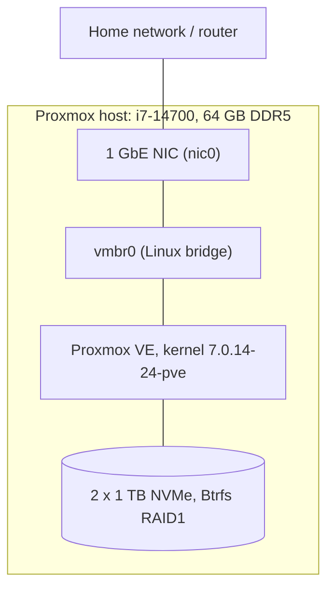

# Cybersecurity Home Lab

A hands-on cybersecurity home lab built on Proxmox VE, documented phase by phase. I'm building it to practice detection, monitoring, network defense, and troubleshooting on infrastructure I run myself, and to keep a record of what worked, what didn't, and why.

Each phase has its own write-up with the commands I ran, the evidence I captured, and the decisions I made.

## Lab Architecture



This shows the current state of the lab. I'll update it as each phase adds components.

## Environment

| Item | Value |
|---|---|
| Hypervisor | Proxmox VE (Debian 13 "trixie") |
| CPU | Intel Core i7-14700 (8P + 12E cores) |
| Motherboard | ASUS PRIME B760M-A AX6 |
| RAM | 64 GB DDR5 (4 x 16 GB), non-ECC |
| Storage | 2 x 1 TB NVMe, Btrfs RAID1 |
| Boot | UEFI, dual ESP via `proxmox-boot-tool` |

## Roadmap

| Phase | Topic | What it will show | Status | Write-up |
|---|---|---|---|---|
| 01 | Proxmox foundation and fault investigation | Stable hypervisor, documented troubleshooting | Complete | [docs/01-proxmox-foundation](docs/01-proxmox-foundation/README.md) |
| 02 | Network segmentation with an OPNsense firewall | VLAN design, firewall rules, NAT, and traffic-flow testing | Planned | |
| 03 | Core lab: Active Directory, Windows and Linux endpoints, Sysmon | Realistic targets that generate useful telemetry | Planned | |
| 04 | Wazuh SIEM and agent deployment | Log collection and a working detection pipeline | Planned | |
| 05 | **Project 1:** Attack simulation, detection and triage | Detections mapped to MITRE ATT&CK, with a triage report | Planned | |
| 06 | **Project 2:** Incident response case study | NIST 800-61 write-up with timeline and lessons learned | Planned | |
| 07 | **Project 3:** Threat hunt and Sigma rules | Hypothesis-driven hunt with ATT&CK-mapped rules | Planned | |
| 08 | **Project 4:** Vulnerability management cycle | Scan, prioritize with CVSS and EPSS, remediate, rescan | Planned | |

### Design choices

- **Firewall:** OPNsense sits between my home network and the lab. I'm using it to practice network fundamentals (segmentation, default-deny rules, NAT) and to enforce which segments can talk to each other.
- **Segments:** management, attacker, victim, and SIEM. The lab segments run on internal Proxmox bridges with no physical port, so attack traffic and scans can only leave through OPNsense and can't reach my home network.

I update the status and add a link as each phase is finished.

## Phase 01 Summary

I deployed a single-node Proxmox VE hypervisor and investigated a reproducible hard reset that happened during a kernel package install. Working one variable at a time, I ruled out package corruption, the install hooks, and the NVMe drives, then showed that the failure depended on Turbo Boost: it reset every time with turbo on and passed every test with turbo off, including two 10-minute stress runs. I did not isolate the failing component, so I documented the suspected causes, the compensating control I used, and my decision to accept the remaining risk for a non-production lab.

[Read the full write-up](docs/01-proxmox-foundation/README.md)

## Skills Demonstrated

- Linux system administration: `apt` and `dpkg` recovery, package holds, kernel pinning
- Hardware fault isolation with a documented, hypothesis-driven method
- Log and evidence analysis: `journalctl`, `dmesg`, NVMe SMART data
- Storage: Btrfs RAID1 health checks
- UEFI boot management with `proxmox-boot-tool`
- Load testing with `stress-ng`
- systemd service authoring
- Risk assessment and documentation of residual risk

## Repository Layout

```
cybersecurity-homelab/
├── README.md                       this page
└── docs/
    └── 01-proxmox-foundation/
        ├── README.md
        └── images/
```

New phases get their own folder under `docs/`.

## Notes

- Everything here runs in a private lab. I redact serial numbers, disk and filesystem identifiers, email addresses, domains, and public IPs from published output.
- Terminal output in the write-ups is transcribed from real sessions, and each write-up says so where it applies.
