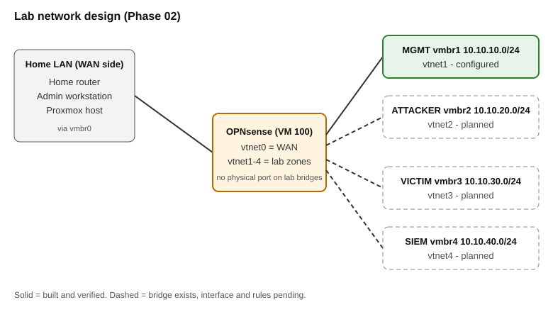
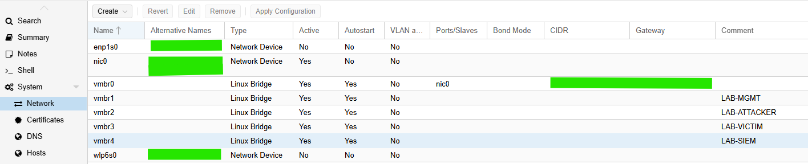
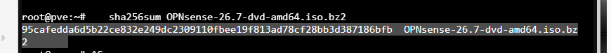
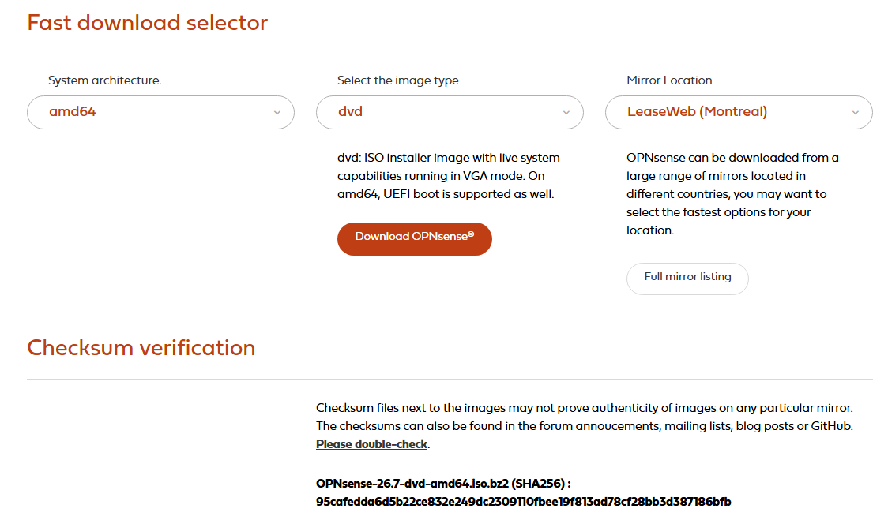
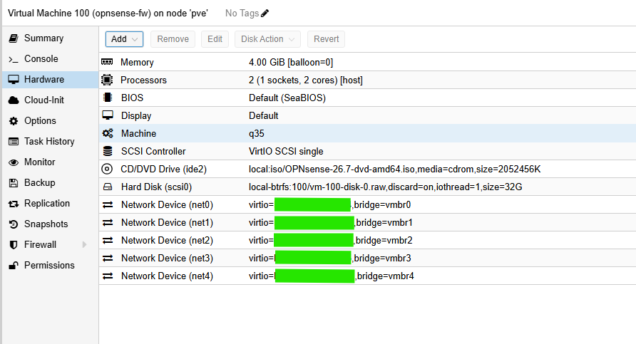
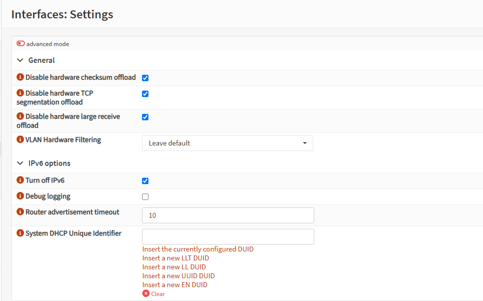
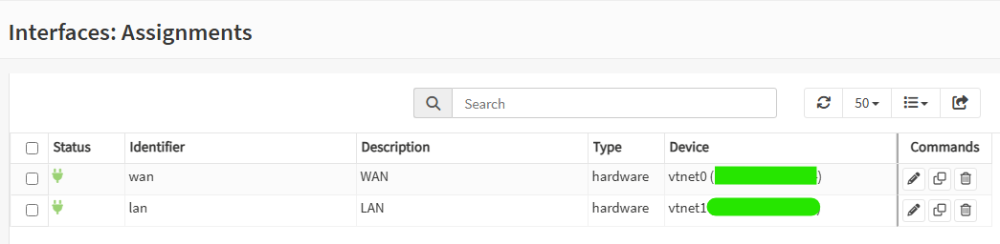
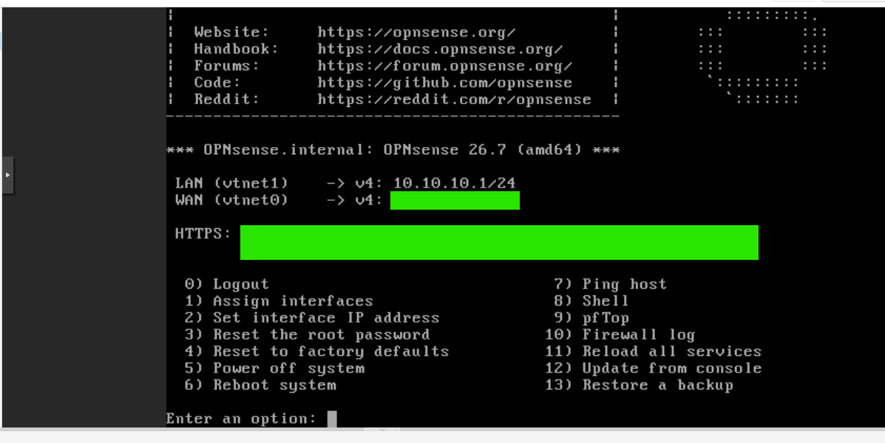
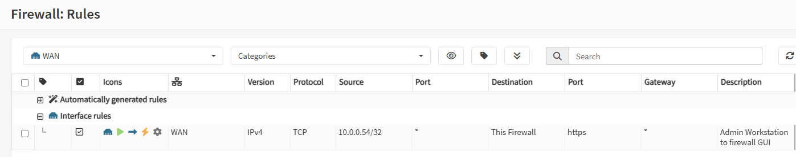
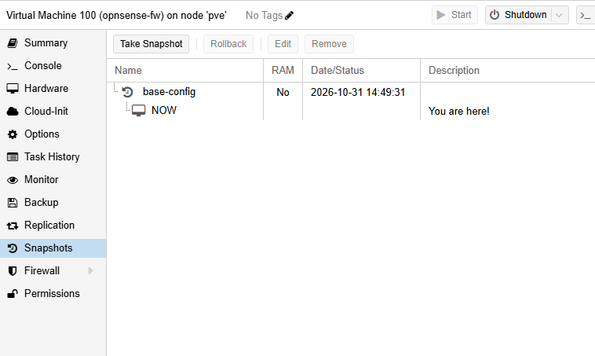

# 02 – Network Segmentation with OPNsense

**Status:** In progress. The firewall VM is deployed and reachable, and the segment bridges exist. Aliases, per-segment rules, and traffic-flow tests are not done yet (see [Verification](#verification)).

## Overview

I am building a four-zone segmented lab (management, attacker, victim, SIEM) behind an OPNsense firewall. The lab segments sit on internal Proxmox bridges with no physical port and no IP on the hypervisor, so every path between zones passes through the firewall. When the rules are finished, I will prove the default-deny policy with logged traffic-flow tests. That gives the later phases (attack simulation, incident response, threat hunting, vulnerability management) clean, attributable network evidence.

This README documents what I have built and verified so far. Anything not yet built is marked as pending.

## What This Demonstrates

Demonstrated so far:

- Building isolated virtual networks on Proxmox (Linux bridges with no ports)
- Deploying a virtual firewall with five NICs and mapping NIC order to interface names
- Verifying a downloaded installer against a published SHA-256 checksum before use
- Identifying and correcting a default interface assignment that put the WAN and LAN on the wrong NICs
- Reducing exposure on a firewall WAN: restricting GUI access to one host, and removing an unneeded IPv6 address
- Recovering from a self-inflicted GUI lockout through the VM console
- Snapshotting and backing up (encrypted) before and after configuration changes

<!-- Add default-deny policy, firewall log analysis, and rule validation only after the tests in the Verification table pass. -->

## Architecture

| Zone | Bridge | Subnet | Firewall NIC | Gateway | Status |
|---|---|---|---|---|---|
| WAN (home LAN) | `vmbr0` | home network (static address on the firewall) | `vtnet0` | home router | Configured |
| MGMT | `vmbr1` | 10.10.10.0/24 | `vtnet1` | 10.10.10.1 | Configured |
| ATTACKER | `vmbr2` | 10.10.20.0/24 | `vtnet2` | 10.10.20.1 | Bridge only; interface pending |
| VICTIM | `vmbr3` | 10.10.30.0/24 | `vtnet3` | 10.10.30.1 | Bridge only; interface pending |
| SIEM | `vmbr4` | 10.10.40.0/24 | `vtnet4` | 10.10.40.1 | Bridge only; interface pending |

`vmbr1` to `vmbr4` have no bridge ports and no IP on the Proxmox host. The lab zones cannot reach the Proxmox UI except through rules I allow on the firewall.



*Planned design. Solid = built, dashed = bridge exists, interface and rules pending.*

## Deployment

### Pre-flight

My node has a known fault where it resets under burst load with Intel Turbo Boost on (documented in Phase 01). Before the download and unpack, I turned turbo off and confirmed it.

Transcribed from my terminal:

```
root@pve:~# uname -r
7.0.14-24-pve
root@pve:~# echo 1 > /sys/devices/system/cpu/intel_pstate/no_turbo
root@pve:~# cat /sys/devices/system/cpu/intel_pstate/no_turbo
1
```

I also created an encrypted archive of the Proxmox configuration (AES-256, passphrase in a password manager) and confirmed that the copy on my workstation matched the original by SHA-256 hash. I decrypted the archive to confirm it contained the VM definition after the VM was created. The backups are stored offline and are not in this repository.

### Bridges

I created `vmbr1` to `vmbr4` in the Proxmox GUI with no bridge ports and no IPv4 address, then applied the configuration. I left `vmbr0` alone.

Transcribed from my terminal (MAC addresses redacted):

```
root@pve:~# ip -br link show type bridge
vmbr0            UP             xx:xx:xx:xx:xx:xx <BROADCAST,MULTICAST,UP,LOWER_UP>
vmbr1            UNKNOWN        xx:xx:xx:xx:xx:xx <BROADCAST,MULTICAST,UP,LOWER_UP>
vmbr2            UNKNOWN        xx:xx:xx:xx:xx:xx <BROADCAST,MULTICAST,UP,LOWER_UP>
vmbr3            UNKNOWN        xx:xx:xx:xx:xx:xx <BROADCAST,MULTICAST,UP,LOWER_UP>
vmbr4            UNKNOWN        xx:xx:xx:xx:xx:xx <BROADCAST,MULTICAST,UP,LOWER_UP>
```

`UNKNOWN` on `vmbr1` to `vmbr4` is expected. The bridges have no ports, so there is no link state to report. After a node restart, all five bridges were still present. The MAC addresses on `vmbr1` to `vmbr4` had changed, which is consistent with bridges generating a new MAC at boot.



### Installer download and verification

I downloaded the OPNsense 26.7 amd64 DVD image from the LeaseWeb (Montreal) mirror to the node and compared its SHA-256 hash with the value published on the OPNsense download page before unpacking it. I compared once during the install, then repeated the check later on a fresh download of the same file to capture the evidence. The repeat download was deleted without unpacking.

Transcribed from my terminal and from the download page:

```
root@pve:~# sha256sum OPNsense-26.7-dvd-amd64.iso.bz2
95cafedda6d5b22ce832e249dc2309110fbee19f813ad78cf28bb3d387186bfb  OPNsense-26.7-dvd-amd64.iso.bz2
```

```
Download page: OPNsense-26.7-dvd-amd64.iso.bz2 (SHA256) :
95cafedda6d5b22ce832e249dc2309110fbee19f813ad78cf28bb3d387186bfb
```

The two values match. A checksum from the same site as the download does not prove the mirror was not tampered with, and the page itself says so. This check detects a corrupted or incomplete download, not a compromised source.

I unpacked the image with `bunzip2` with turbo off. The node did not reset, and the unpacked ISO was about 2 GB.




### OPNsense VM

| Setting | Value |
|---|---|
| Name / VMID | `opnsense-fw` / 100 |
| Machine / BIOS | q35 / SeaBIOS |
| CPU | 2 cores, type `host` |
| RAM | 4 GiB, ballooning off |
| Disk | 32 GB, VirtIO SCSI single, raw, discard on, on Btrfs-backed storage |
| NICs | 5 × VirtIO: `net0`=`vmbr0` through `net4`=`vmbr4`, Proxmox firewall off on each |
| Start at boot | Yes |

I used raw disk format to avoid copy-on-write layered on Btrfs. NIC order matters because `net0` to `net4` map to `vtnet0` to `vtnet4` inside OPNsense.



I installed with the UFS option, then set the VM's CD/DVD drive to "Do not use any media" so it boots from disk.

## Configuration

### Interface assignment

After the install, OPNsense assigned **LAN to `vtnet0` and WAN to `vtnet1`**. That is the reverse of my design, where `vtnet0` is on `vmbr0` (my home network) and `vtnet1` is the management segment. Left alone, the firewall would have treated my home network as its LAN. I reassigned the interfaces from the console menu before configuring anything else.

Transcribed from the console menu after the fix (addresses on the WAN line redacted):

```
LAN (vtnet1)    -> v4: 10.10.10.1/24
WAN (vtnet0)    -> v4/DHCP4: <redacted>/24
                   v6/DHCP6: <redacted>
```

The WAN first received an address by DHCP from my home router. I then moved it to a static address outside the router's DHCP pool, set the upstream gateway to the router, and set the router as the DNS server. I disabled DHCPv6 in the console and later set IPv6 to None in the web interface (see Findings).

Hardware checksum offload, TCP segmentation offload, and large receive offload are disabled under Interfaces → Settings, which is standard for a virtualized firewall. I also ticked "Turn off IPv6" on the same page to disable IPv6 system-wide, since the lab does not use it.





Console menu after IPv6 was set to None. The WAN shows only an IPv4 line. WAN address and HTTPS fingerprint are redacted:



### WAN access and rules

My workstation is on the same network as the firewall's WAN. To reach the GUI I added one WAN rule:

| Action | Protocol | Source | Destination | Port | Description |
|---|---|---|---|---|---|
| Pass | TCP | single admin workstation (/32) | This Firewall | 443 | Admin workstation to firewall GUI |



### Compensating controls and accepted risks

| Item | Type | Notes |
|---|---|---|
| WAN "Block private networks" unticked | **Accepted risk** | The WAN is my private home LAN behind NAT, so this block would break access. |
| WAN GUI rule limited to one /32 | **Compensating control** | Only my admin workstation can reach the GUI from the WAN side. To be removed once a jump host exists. |
| IPv6 set to None on the WAN, and "Turn off IPv6" enabled system-wide | **Compensating control** | The lab is IPv4-only. This removed a publicly routable address from the WAN. |
| Default "allow LAN to any" rules still present on MGMT | **Temporary, pending removal** | No VMs are attached to MGMT yet. Removal is the first rule step of the next stage. |
| No port forwards, no UPnP | Control | None configured. |

### Snapshot and backups

I took a Proxmox snapshot of VM 100 named `base-config` (RAM not included) after the base configuration. I also made encrypted backups of the Proxmox configuration, kept offline. I did not commit any backup or the OPNsense `config.xml`, because they contain credential hashes and keys.



## Detection / Investigation

Not started. Once the segment rules exist, I will use Firewall → Log Files → Live View to confirm each blocked path in the tests below, and add the log evidence here.

## Findings

1. **Default interface assignment was reversed.** OPNsense put LAN on `vtnet0` and WAN on `vtnet1`. I caught it from the console menu before configuring anything and reassigned the interfaces.
2. **Self-inflicted GUI lockout.** To reach the GUI from the WAN side, I disabled the packet filter from the console (`pfctl -d`), then saved a WAN setting and applied it before adding the admin allow rule. I lost GUI access. **Hypothesis (not tested):** applying the change reloaded the ruleset and turned the packet filter back on, so the default deny blocked me before my allow rule existed. I recovered through the Proxmox VM console by disabling the packet filter again, adding the rule, and applying once. Lesson: add the allow rule before applying.
3. **WAN picked up a public IPv6 address.** Even after I cleared DHCPv6 in the console, the console still showed an IPv6 address. **Hypothesis (not tested):** it came from router advertisements (SLAAC) rather than DHCPv6. After I set IPv6 to None in the web interface, the console menu no longer showed an IPv6 line. I then also enabled the system-wide "Turn off IPv6" setting.
4. **GUI appeared unreachable after the static IP change.** My browser defaulted to `http://`. The GUI listens on HTTPS, and the page loaded once I typed `https://`.
5. **Settings persisted across a firewall reboot.** After a reboot, the GUI was reachable at the static address with the admin rule intact.
6. **Brief link drop on the node (untested cause).** The Proxmox journal showed the physical NIC link go down and come back about 8 seconds later, with no reboot. I did not investigate further. Possible causes are the cable, the router port, or the NIC.

## Verification

| ID | Test | Expected | Result | Evidence |
|---|---|---|---|---|
| V01 | Bridges `vmbr1`–`vmbr4` exist with no ports | Present | Pass | `01-bridges.png` |
| V02 | Installer SHA-256 matches published value | Match | Pass | `03a`, `03b` |
| V03 | WAN and LAN on the intended NICs | `vtnet0` / `vtnet1` | Pass (after fix) | `04-interfaces-assigned.png` |
| V04 | GUI reachable after firewall reboot | Reachable | Pass | Observed; no screenshot |
| T01 | Any segment → gateway DNS | Pass | pending | |
| T02 | VICTIM → internet HTTPS | Pass | pending | |
| T03 | VICTIM → home router | Blocked, logged | pending | |
| T04 | VICTIM / ATTACKER / SIEM → Proxmox :8006 | Blocked, logged | pending | |
| T05a/b | ATTACKER → VICTIM :22, rule disabled then enabled | Blocked, then pass | pending | |
| T06 | ATTACKER → SIEM :443 | Blocked | pending | |
| T07 | ATTACKER → firewall GUI | Blocked | pending | |
| T08a/b | MGMT → VICTIM :22; VICTIM → MGMT :22 | Pass; blocked | pending | |
| T09 | VICTIM → SIEM :1514 (placeholder) | Blocked | pending | |
| T10 | Non-admin host → firewall WAN :443 | Blocked | not testable yet (only one host on the home network) | |

## Next

Add the remaining interfaces and an RFC1918 alias, remove the default allow rules, build the per-segment rules, then run the traffic tests above. After that: [03 – Core lab (AD, endpoints, Sysmon)](../03-core-lab/README.md).
